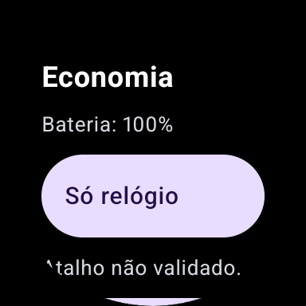
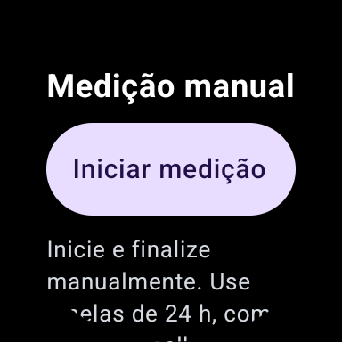

# WatchReserve

Open Samsung's **Watch only** confirmation from a tile, a watch face complication, or a double press of Home. WatchReserve puts manual battery settings within reach on your Galaxy Watch. You still choose whether to turn the mode on.

**[Download the technical preview (v0.2.2)](https://github.com/brenopoubel0324/watchreserve-app/releases/download/v0.2.2/WatchReserve-0.2.2.apk)** · [SHA-256](https://github.com/brenopoubel0324/watchreserve-app/releases/download/v0.2.2/WatchReserve-0.2.2.apk.sha256) · [Release notes](https://github.com/brenopoubel0324/watchreserve-app/releases/tag/v0.2.2)

## Compatibility

WatchReserve targets **Galaxy Watch4 and newer models with Wear OS and Android API 30 or later**. The direct shortcut was confirmed on **Galaxy Watch8 LTE, 40 mm (SM-L325F)**, running firmware **L325FXXS3AZF4**. Other models and firmware need their own check. Older Tizen watches cannot install the APK. The app's interface is in Brazilian Portuguese.

[What was tested](COMPATIBILITY.md) · [Previous previews](https://github.com/brenopoubel0324/watchreserve-app/releases)

*Wear OS 5 emulator screenshot from the v0.2.2 test build. The shortcut is shown before validation.*

## Install and set up

1. Follow the [installation guide](INSTALL.md) to sideload the APK onto the watch. Existing signed previews, including **Watch8-Battery v0.1.0**, can update over the installed copy.
2. Add the **Economia** (Power saving) tile and tap its **Economia** button to open the panel. Choose **Configurar Só relógio** (Configure Watch only), then **Buscar tela Samsung** (Find Samsung screen). Tap **Salvar candidata** (Save candidate) and **Testar abertura** (Test opening). Return without activating the mode and tap **Confirmar tela correta** (Confirm correct screen) only if you saw Samsung's own confirmation screen.
3. Use the tile's **Só relógio** button, add the WatchReserve complication to a compatible watch face, or assign **Só relógio** to the Home button's double press if your watch offers it. The entry may appear as **WatchReserve** in Samsung's picker.

Recheck the shortcut after a firmware update. When the direct shortcut is unavailable, the app opens a broader settings screen so you can continue there. WatchReserve runs on your watch without a paired phone during everyday use. It has no continuous battery monitor and requires no privileged permissions or bridge app. Wireless debugging can be turned off after installation.

See manual battery measurement

*Wear OS 5 emulator screenshot from the v0.2.2 test build.*

## Support

[Report a problem](https://github.com/brenopoubel0324/watchreserve-app/issues/new) with the WatchReserve version, watch model, firmware version, and the entry point you tried. Leave out serial numbers, network addresses, raw diagnostics, and personal screenshots.

[Third-party notices](THIRD_PARTY_NOTICES.md)
